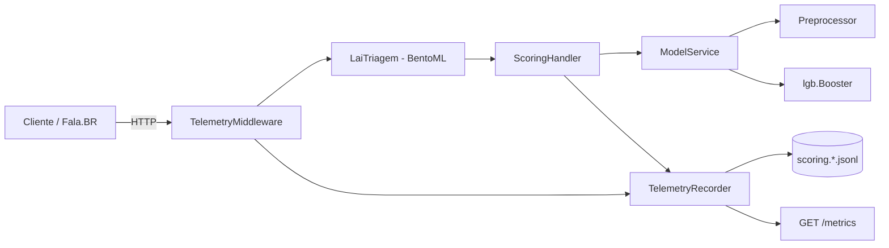
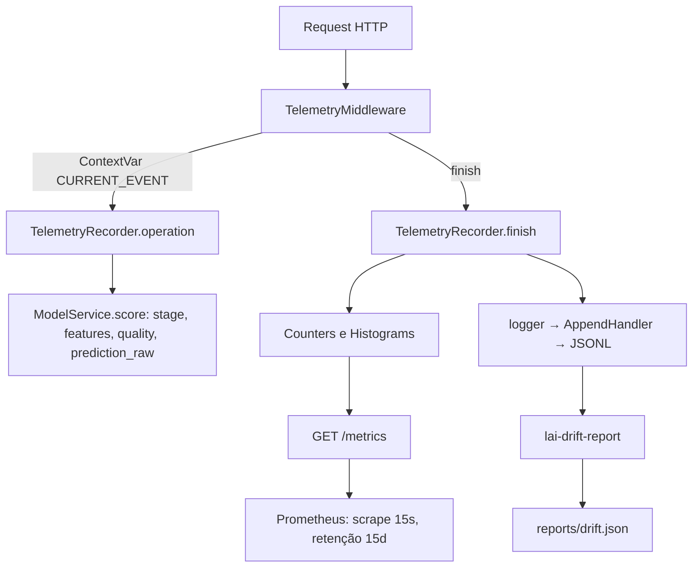

# Contexto do projeto `lai-triagem`

Mapeamento do que o repositório contém hoje: domínio do problema, modelo,
serviço e endpoints, pipelines, observabilidade e infraestrutura.

---

## 1. Domínio do problema

### 1.1 Objetivo

Pedidos de acesso à informação (LAI) chegam ao Fala.BR destinados a um órgão.
Parte deles é **reencaminhada internamente** para outro órgão, o que atrasa o
atendimento. O serviço estima, **no instante da chegada do pedido**, a
probabilidade de ele ser reencaminhado.

- **Alvo:** `FoiReencaminhado` (binário; `prepare.py` normaliza `sim/não`,
  `yes/no`, `true/false`, `1/0`).
- **Saída principal:** `probabilidade_reencaminhamento` ∈ [0, 1] e
  `alerta` = `ALTO RISCO` se escore ≥ `threshold`, senão `BAIXO RISCO`.
- **Uso:** priorizar a fila de análise humana. O modelo não toma a decisão
  administrativa; analistas seniores usam o escore para ordenar o trabalho.

### 1.2 Processo de negócio

Antes: o pedido entra na fila sem priorização por risco e a análise é manual;
o desfecho (`FoiReencaminhado`) só existe depois.

Depois:

1. O Fala.BR envia à API o pedido e, quando autorizado, os 8 campos de
   histórico do solicitante.
2. O contrato valida datas, tipos e campos permitidos.
3. O pré-processador gera as mesmas features do treinamento e rejeita campos
   posteriores à triagem.
4. O modelo calcula o escore; o serviço devolve risco, threshold e sinais de
   auditoria (`model_version`, taxas do órgão, flags de histórico).
5. A decisão final continua humana.
6. A telemetria registra entradas, features e previsões para monitoramento.

### 1.3 Dados

- Fonte: portal de Dados Abertos da CGU. Dados brutos e pessoais não são
  versionados.
- Snapshot: `20260914` (`params.yaml`).
- Corte temporal (`configs/base.yaml`): treino 2022–2024, validação 2025,
  teste 2026.
- `maturity_days = 60`: o rótulo só entra em estatísticas de órgão após 60
  dias, para não usar pedidos sem desfecho.
- `base_rate` do treino: ≈ 0,0803 (8,03% de reencaminhamento).

### 1.4 Features (31)

Ordem e listas estão em `artifacts/registered/preprocessor.json`
(`feature_order`, `categorical_features`, `numeric_features`).

**Categóricas (14)** — codificadas por `category_codes` (vocabulário do
treino); valor ausente ou desconhecido vira `-1`:

`Esfera`, `UF`, `Municipio`, `OrgaoDestinatario`, `FormaResposta`,
`OrigemSolicitacao`, `TipoDemandante`, `Genero`, `Escolaridade`, `Profissao`,
`TipoPessoaJuridica`, `Pais`, `UF_sol`, `Municipio_sol`.

**Numéricas (17):**

| Grupo | Features | Origem |
| --- | --- | --- |
| Data | `reg_month`, `reg_dow`, `reg_day` | `DataRegistro` |
| Idade | `idade` | `DataRegistro − DataNascimento`, válida em [10, 110] anos, senão `NaN` |
| Órgão | `orgao_rate`, `orgao_rate_movel_90d`, `orgao_rate_movel_365d` | Tabelas embarcadas no artefato; órgão desconhecido usa `base_rate` |
| Órgão | `dias_desde_primeiro_pedido_do_orgao` | `DataRegistro − organ_birth[órgão]` |
| Cruzamento | `uf_match` | `UF_sol == UF` |
| Histórico do solicitante | `n_pedidos_previos`, `prev_reenc_solicitante`, `n_pedidos_previos_neste_orgao`, `prev_reenc_neste_orgao`, `n_orgaos_distintos_previos`, `dias_desde_ultimo_pedido` | Enviados pelo chamador |
| Derivadas do histórico | `prev_reenc_rate_solicitante`, `prev_reenc_rate_neste_orgao` | Numerador / denominador (`*_den`) quando denominador > 0, senão `-1` |

Taxas por órgão usam suavização bayesiana em direção à `base_rate`
(prior 50 para a taxa histórica, 20 para as janelas móveis). No treino, essas
taxas são calculadas de forma causal (`causal_organ_rate`): cada linha só vê
rótulos de pedidos anteriores já maturados.

### 1.5 Regras de domínio

1. **Barreira de leakage (`LEAKAGE_FIELDS`)** — campos que só existem após a
   triagem são recusados com `ContractError` (HTTP 400): `Situacao`,
   `FoiProrrogado`, `FoiReencaminhado`, `DataResposta`, `Decisao`,
   `EspecificacaoDecisao`, `DetalhamentoDecisao`, `MotivoNegativaAcesso`,
   `PrazoRestricaoAcesso`, `AssuntoPedido`, `SubAssuntoPedido`, `Tag`,
   `PrazoAtendimento`, `prazo_dias`, `ProtocoloPedido`, `protocolo_seq`.
2. **Contrato fechado (`REQUEST_FIELDS`)** — qualquer campo fora da lista de
   chegada é recusado (`campos fora do contrato de chegada`).
3. **Histórico atômico** — os 8 campos de histórico (`caller_supplied_features`)
   valem só se chegarem todos. Envio parcial é descartado: todos viram `-1` e a
   resposta indica `historico_parcial_ignorado: true`.
4. **Sem dados pessoais no artefato** — o histórico vem do chamador a cada
   chamada; `contains_personal_data: false` é verificado na validação.
5. **Calibração isotônica somente leitura** — `probabilidade_calibrada` é
   devolvida, mas `alerta` usa o escore bruto (`calibrada_apenas_para_leitura: true`).
6. **Threshold de fila** — `threshold = quantil(1 − queue_fraction)` dos
   escores de validação, com `queue_fraction = 0.10`. Valor registrado:
   `0.159391` (≈ 10% dos pedidos marcados como alto risco).

### 1.6 Desempenho do artefato registrado

Fonte: `preprocessor.json → metrics.arrival` (modelo em produção).

| Conjunto | ROC AUC | PR AUC | Precisão top 1% | top 5% | top 10% |
| --- | ---: | ---: | ---: | ---: | ---: |
| Validação 2025 | 0,781 | 0,222 | 0,434 | 0,287 | 0,241 |
| Teste 2026 | 0,771 | 0,177 | 0,348 | 0,226 | 0,181 |
| Teste 2026 (maturado) | 0,773 | 0,190 | 0,365 | 0,242 | 0,196 |

Com taxa base de 8%, o top 10% concentra ≈ 2,3× a taxa média.

O mesmo campo `metrics` guarda variantes comparadas durante a modelagem:

- `with_assunto` — inclui assunto; desempenho de teste inferior.
- `LEAKY_with_prazo` — usa prazo (leakage); ROC AUC ≈ 0,85, inválido em produção.
- `SEM_demografia_H6` — sem variáveis demográficas (`h6_affected_features`);
  desempenho próximo ao modelo de chegada.

`precision_at_k` (`src/mlops_lai/metrics.py`) calcula a precisão esperada no
topo de forma determinística quando há empates de escore.

---

## 2. Estrutura do repositório

```text
lai-triagem/
├── src/mlops_lai/
│   ├── service.py                 # BentoML (LaiTriagem) + ScoringHandler
│   ├── domain/schemas.py          # PedidoLAI, ScoreResponse, BaselineResponse, HealthResponse
│   ├── features/preprocessor.py   # contrato, leakage, transform, qualidade, calibração
│   ├── model/loader.py            # manifesto, SHA-256, LightGBM, score e baseline
│   ├── core/settings.py           # Settings (MLOPS_*)
│   ├── core/errors.py             # ContractError, ArtifactError
│   ├── metrics.py                 # precision_at_k
│   ├── pipelines/                 # prepare, train, evaluate, validate_artifact, promote, common
│   └── monitoring/                # telemetry, middleware, drift
├── artifacts/registered/          # modelo servido (model_arrival.txt, preprocessor.json, manifest.json)
├── artifacts/generated/           # saída do lai-train
├── configs/base.yaml              # config de dados, split, modelo e relatórios
├── params.yaml                    # parâmetros do snapshot
├── monitoring/prometheus.yml      # scrape do Prometheus
├── monitoring/telemetry/          # destino dos JSONL
├── scripts/generate_load.py       # carga sintética
├── tests/                         # pytest (25 testes)
├── docs/                          # APRESENTACAO.md, DELIVERY_AUDIT.md, EXECUTION_EVIDENCE.md, monitoramento.xlsx
├── Dockerfile, docker-compose.yml, docker-compose.monitoring.yml
├── bentofile.yaml, Makefile, pyproject.toml, uv.lock, .env.example
└── .github/workflows/ci.yml
```

Dependências principais (`pyproject.toml`, Python ≥ 3.11 e < 3.14):
`bentoml 1.4.39`, `pydantic 2.13.5`, `pydantic-settings 2.15.0`,
`lightgbm 4.7.0`, `pandas 2.3.3`, `numpy 2.3.4`, `scikit-learn 1.9.1`,
`pyarrow 24.0.0`, `PyYAML 6.0.3`, `prometheus-client 0.26.0`.
Dev: `pytest`, `pytest-cov`, `ruff`, `mypy`, `uv`.

---

## 3. Serviço e endpoints

### 3.1 Camadas



| Camada | Arquivo | Responsabilidade |
| --- | --- | --- |
| Contrato HTTP | `domain/schemas.py` | `PedidoLAI`: `OrgaoDestinatario` (1–500 chars) e `DataRegistro` obrigatórios; datas `DD/MM/AAAA`; histórico `float ≥ 0`; `extra="allow"` para que o domínio classifique campos extras; strings com `strip` |
| API | `service.py` → `LaiTriagem` | `@bentoml.service(name="lai-triagem")`, timeout `request_timeout_seconds + 1`, `cpu: 2`; converte `ContractError` em `BadInput` (400); fecha a telemetria em `on_shutdown` |
| Adaptador | `service.py` → `ScoringHandler` | Carrega `ModelService` e o `TelemetryRecorder`; implementa `score`, `score_baseline`, `health`, `metadata`; testável sem servidor |
| Modelo | `model/loader.py` → `ModelService` | Lê `manifest.json`, confere versão esperada e SHA-256 de modelo e pré-processador, carrega o booster a partir do texto do modelo, confere nº de features |
| Features | `features/preprocessor.py` → `Preprocessor` | `validate_payload`, `transform` (DataFrame 1×31 `float64`), `history_state`, `monitoring_state`, `calibrate`; `risk_label` |
| Configuração | `core/settings.py` | `Settings` com prefixo `MLOPS_` e `.env` opcional; caminhos relativos resolvidos a partir da raiz |
| Erros | `core/errors.py` | `ContractError` (violação de contrato) e `ArtifactError` (artefato inválido ou alterado) |

### 3.2 Endpoints

| Método e rota | Descrição | Resposta |
| --- | --- | --- |
| `POST /score` | Inferência LightGBM | `probabilidade_reencaminhamento`, `alerta`, `threshold`, `probabilidade_calibrada`, `calibrada_apenas_para_leitura`, `orgao_conhecido`, `orgao_rate_historica`, `orgao_rate_movel_90d`, `base_rate_coorte`, `historico_informado`, `historico_parcial_ignorado`, `model_version` |
| `POST /score_baseline` | Lookup da taxa histórica do órgão, sem modelo, com o mesmo threshold | `probabilidade_reencaminhamento`, `alerta`, `metodo`, `orgao_conhecido`, `model_version` |
| `POST /health` | Saúde e integridade | `status`, `model_version`, `artifact_sha256`, `n_features`, `threshold`, `train_years`, `personal_data_embedded` |
| `POST /metadata` | Contrato e metadados | `model_version`, `feature_count`, `request_history_fields`, `leakage_fields_rejected`, `artifact_source` |
| `GET /healthz`, `/readyz`, `/livez` | Sondas nativas do BentoML | — |
| `GET /metrics` | Exposição Prometheus (BentoML + métricas `lai_*`) | texto Prometheus |

Corpo das requisições de inferência: `{"pedido": {...}}`. Toda resposta recebe
o cabeçalho `X-Request-ID`.

Exemplo:

```bash
curl -sS -X POST http://localhost:3000/score \
  -H 'Content-Type: application/json' \
  -d '{"pedido":{"OrgaoDestinatario":"CC-PR – Casa Civil da Presidência da República","DataRegistro":"15/09/2026"}}'
```

### 3.3 Fluxo de `/score`

1. Pydantic valida `PedidoLAI` (erro → 400 do BentoML).
2. `ScoringHandler.score` abre `telemetry.operation("/score", payload)`.
3. `ModelService.score`:
   - `stage=preprocessing`: `Preprocessor.transform` valida leakage e
     contrato, aplica histórico atômico e gera as 31 features;
   - grava `features` e `quality` no evento;
   - `stage=inference`: `booster.predict`;
   - `stage=calibration`: interpolação isotônica (`np.interp` em `grid/image`);
   - monta a resposta.
4. `inference_ms` e `LATENCY` medem `model.score`.
5. O middleware captura a resposta e finaliza o evento.

### 3.4 Artefato registrado (`artifacts/registered/`)

| Arquivo | Conteúdo |
| --- | --- |
| `model_arrival.txt` | Booster LightGBM em formato texto nativo (sem pickle) |
| `preprocessor.json` | `feature_order`, listas de features, `category_codes`, `organ_rate` (759 órgãos), `organ_rate_movel_90d/365d` (867), `organ_birth` (877), `base_rate`, `threshold`, `queue_fraction`, `caller_supplied_*`, `derived_from_caller`, `calibration`, `excluded_leakage_features`, `metrics`, `h6_affected_features`, `train_years`, `data_snapshot`, `created_utc` |
| `manifest.json` | Arquivos, SHA-256 de cada um, `model_version = provided-2026-09-21`, `source` |

No startup, qualquer divergência de hash, versão ou nº de features gera
`ArtifactError` e o serviço não sobe.

### 3.5 Configuração (`MLOPS_*`)

| Variável | Padrão | Uso |
| --- | --- | --- |
| `MLOPS_ENV` | `development` | Ambiente |
| `MLOPS_ARTIFACT_DIR` | `artifacts/registered` | Diretório do artefato |
| `MLOPS_MODEL_VERSION` | `provided-2026-09-21` | Versão esperada no manifesto |
| `MLOPS_ENABLE_TELEMETRY` | `true` | Liga a gravação JSONL |
| `MLOPS_TELEMETRY_PATH` | `monitoring/telemetry/scoring.jsonl` | Base do nome dos arquivos |
| `MLOPS_LOG_LEVEL` | `INFO` | Nível de log declarado |
| `MLOPS_REQUEST_TIMEOUT_SECONDS` | `20` | Prazo HTTP do middleware |

---

## 4. Pipelines de modelo

Comandos definidos em `pyproject.toml → [project.scripts]`:

| Comando | Módulo | O que faz |
| --- | --- | --- |
| `lai-prepare` | `pipelines/prepare.py` | Lê CSV UTF-8 ou UTF-16/`;` (formato CGU), limpa texto, normaliza alvo, cria `year`, data, `idade`, `uf_match`, histórico (`-1` se ausente) e taxas derivadas; grava `data/processed/training.parquet` |
| `lai-train` | `pipelines/train.py` | Split temporal com checagem de sobreposição; vocabulários e taxas de órgão ajustados só no treino; taxas causais no treino; LightGBM binário com early stopping na validação; threshold por quantil; calibração isotônica; grava `model.txt`, `preprocessor.json`, `manifest.json` em `artifacts/generated` e `reports/training_metrics.json` |
| `lai-evaluate` | `pipelines/evaluate.py` | Reavalia o ano de teste chamando `ModelService.score` (mesmo caminho da API); grava `reports/evaluation.json` |
| `lai-validate-artifact` | `pipelines/validate_artifact.py` | Portão: integridade, ausência de features de leakage, ausência de chave pessoal nas tabelas, `contains_personal_data=false` |
| `lai-promote` | `pipelines/promote.py` | Valida e copia o artefato para um destino novo; recusa sobrescrever |
| `lai-drift-report` | `monitoring/drift.py` | Relatório de drift a partir da telemetria |

Hiperparâmetros (`configs/base.yaml`): `learning_rate 0.05`, `num_leaves 31`,
`feature_fraction 0.9`, `bagging_fraction 0.9`, `bagging_freq 1`,
`min_data_in_leaf 30`, `num_boost_round 500`, `early_stopping_rounds 50`,
`seed 42`.

`pipelines/common.py` concentra `load_config`, `resolve` e `write_manifest`.

---

## 5. Logs e observabilidade

### 5.1 Visão geral



Três peças:

1. **Eventos JSONL** por requisição (`monitoring/telemetry.py`).
2. **Middleware ASGI** que observa todo o ciclo HTTP (`monitoring/middleware.py`).
3. **Métricas Prometheus** expostas em `/metrics`, com coleta opcional por
   Prometheus via Docker.

E uma análise offline: **drift** (`monitoring/drift.py`).

### 5.2 Eventos JSONL (`TelemetryRecorder`)

- **Arquivo:** `monitoring/telemetry/scoring.<instance_id>.<pid>.jsonl`, um por
  processo, evitando entrelaçamento entre workers e preservando execuções
  anteriores.
- **Gravação:** `logging` da biblioteca padrão. `AppendHandler` herda de
  `logging.FileHandler` (`mode="a"`, UTF-8, flush por evento) e propaga falhas
  em vez de silenciá-las. O logger `mlops_lai.events.<instance_id>` não propaga
  para o root.
- **Formato:** `JsonFormatter` produz JSON estrito (`ensure_ascii=False`,
  `allow_nan=False`); `json_safe` converte escalares NumPy e transforma
  `NaN`/`Inf` em `null`. Timestamps em UTC (`time.gmtime`) no formato
  `YYYY-MM-DD HH:MM:SS,mmm`.
- **Instância única por processo:** `get_recorder` usa `lru_cache` e recria o
  gravador se os handlers tiverem sido fechados.
- **Falha de escrita:** incrementa `lai_telemetry_write_failures_total` e
  registra a exceção em stderr; a requisição não falha por isso.

**Esquema do evento (`schema_version: 2`):**

| Campo | Conteúdo |
| --- | --- |
| `schema_version` | `2` |
| `event_type` | `inference_completed` (`/score`, `/score_baseline`) ou `http_completed` |
| `request_id` | UUID; também no cabeçalho `X-Request-ID` |
| `instance_id`, `process_id` | Identificação do gravador |
| `started_at_utc`, `timestamp_utc` | Início e conclusão |
| `endpoint`, `method`, `transport` | Rota observada ou `unmatched`; método; `http` ou `python` |
| `http_status`, `outcome` | Status enviado; `success`, `validation_error`, `server_error`, `cancelled` |
| `latency_ms`, `inference_ms` | Duração total; duração de `model.score` |
| `model_version`, `artifact_sha256` | Proveniência |
| `categorical_features` | Lista das 14 categóricas (usada para filtrar análises numéricas) |
| `input` | Campos escalares de `REQUEST_FIELDS`, exceto `DataNascimento` |
| `features` | As 31 features entregues ao booster (`/score` com sucesso) |
| `quality` | Indicadores de qualidade (ver 5.3) |
| `response` | Corpo de sucesso, ou `{"error", "http_status"}` em erro |
| `prediction_raw` | Escore bruto do LightGBM (ou taxa do órgão no baseline) |
| `error` | `kind`, `stage`, `fields` e, quando houver, `validation` (`type`, `loc` do Pydantic, sem o valor) |
| `score_bin`, `organ_known`, `history_supplied` | Atalhos em `/score` com sucesso; `score_bin = min(int(score*10), 9)` |
| `request_body_truncated` | `true` se o corpo passar de 64 KB |

### 5.3 Qualidade da entrada (`Preprocessor.monitoring_state`)

`orgao_conhecido`, `historico_informado`, `historico_parcial_ignorado`,
`history_fields_received`, `history_field_count`, `missing_fields`,
`unknown_categories`, `rejected_fields`, `leakage_fields`,
`birth_date_supplied`, `age_state` (`valid`, `invalid`, `absent`,
`not_processed`), `default_features` (categóricas em `-1` e histórico na
sentinela), `missing_features` (`NaN`), `unknown_organ`, `history_absent`,
`history_partial`.

Privacidade: a data de nascimento bruta não é gravada (somente `idade` e
indicadores); erros de validação guardam tipo e localização, não o valor.

### 5.4 Middleware ASGI (`TelemetryMiddleware`)

- Registrado com `LaiTriagem.add_asgi_middleware(TelemetryMiddleware)`.
- Cria o evento no início da requisição e o publica em `CURRENT_EVENT`
  (`ContextVar`); o handler reutiliza o mesmo evento, gerando **um registro
  por requisição**.
- Rotas observadas: `/score`, `/score_baseline`, `/health`, `/metadata`,
  `/healthz`, `/readyz`, `/livez`; demais viram `unmatched`. `/metrics` é
  ignorada.
- Captura até 64 KB do corpo da requisição (extrai `pedido` para `input` e
  `quality`) e da resposta (guarda o JSON de sucesso ou os detalhes de erro).
- Aplica prazo próprio com `asyncio.timeout` (20 s) e responde `504`; o
  runtime BentoML recebe 21 s para não competir com esse prazo.
- Em exceção não tratada sem resposta iniciada, responde `500`.
- Classificação de `error.kind`: `invalid_json`, `http_validation`,
  `unknown_fields`, `leakage_fields`, `model_error`, `timeout`, `cancelled`,
  `server_error`, `incomplete_response`, `invalid_response_json`.

### 5.5 Métricas Prometheus

Registradas no registry padrão do `prometheus_client`, expostas pelo BentoML
em `GET /metrics` junto das métricas nativas (`bentoml_*`, `python_*`,
`process_*`).

| Métrica | Tipo | Labels | Observação |
| --- | --- | --- | --- |
| `lai_http_requests_total` | Counter | `endpoint`, `method`, `status_class` (`2xx`, `4xx`, `5xx`, `cancelled`) | Volume e base da taxa de erro |
| `lai_http_request_duration_seconds` | Histogram | `endpoint`, `method` | Buckets 0,005 a 20 s |
| `lai_score_requests_total` | Counter | `model_version`, `known_organ` | `/score` com sucesso |
| `lai_score_failures_total` | Counter | `kind` | Uma vez por inferência malsucedida |
| `lai_score_latency_seconds` | Histogram | — | Só `model.score` |
| `lai_prediction_score` | Histogram | `endpoint`, `model_version` | Buckets 0,0 a 1,0 em passos de 0,1 |
| `lai_risk_predictions_total` | Counter | `endpoint`, `model_version`, `risk` | Proporção de alto risco |
| `lai_input_quality_events_total` | Counter | `kind` (`unknown_organ`, `history_absent`, `history_partial`, `unknown_categories`) | Uma chamada pode somar em mais de um `kind` |
| `lai_telemetry_write_failures_total` | Counter | — | Falhas de escrita do JSONL |

Exemplos de PromQL (de `docs/APRESENTACAO.md`):

```promql
sum by (endpoint) (rate(lai_http_requests_total{status_class=~"4xx|5xx"}[5m]))
/
sum by (endpoint) (rate(lai_http_requests_total{status_class=~"[1-5]xx"}[5m]))
```

```promql
sum by (kind) (rate(lai_score_failures_total[5m]))
```

### 5.6 Coleta e retenção

| Informação | Preservação |
| --- | --- |
| Acumulados em `/metrics` | Enquanto o processo estiver vivo |
| JSONL | Em disco até remoção; no Docker, volume `telemetry-data` |
| Prometheus | `monitoring/prometheus.yml`: scrape de `api:3000/metrics` a cada 15 s; `docker-compose.monitoring.yml`: `prom/prometheus:v2.54.1`, retenção 15 dias, volume `prometheus-data`, porta 9090 |

### 5.7 Drift offline (`lai-drift-report`)

```bash
uv run lai-drift-report --telemetry monitoring/telemetry --reference-rows 20
# ou com referência fixa:
uv run lai-drift-report --reference caminho/referencia.jsonl
```

- `load_events`: junta todos os `*.jsonl` e ordena por `(timestamp_utc, request_id)`.
- `valid_scores`: mantém `/score` com sucesso (e eventos legados v1 com
  `score_bin`), filtra por `--model-version`, recusa `request_id` duplicado e
  mistura de versões.
- Referência: prefixo cronológico (`--reference-rows`) ou arquivo fixo
  (`--reference`) sem sobreposição de `request_id`; o relatório guarda o
  SHA-256 da referência (`reference_id`).
- Estatísticas:
  - **PSI do escore** em 10 faixas (`score_bin`); `status = alert` se ≥ 0,2;
  - **numéricas** (`features.*`, `response.*`, `input.*`, `prediction_raw`):
    KS D, PSI com faixas por decis da referência, resumo com quartis, IQR,
    bigodes de Tukey, outliers e histograma;
  - **categóricas** (`input.*` texto): contagens e PSI;
  - categóricas codificadas e features em valor padrão são excluídas das
    numéricas.
- `min_samples` (padrão 20): abaixo disso, o resultado é `inconclusive`.
- Saída: `reports/drift.json` e resumo no stdout.

### 5.8 Carga sintética (`scripts/generate_load.py`)

```bash
uv run python scripts/generate_load.py --requests 120 --concurrency 4
```

12 cenários determinísticos (seed 42), distribuídos em rodízio e embaralhados:

| Cenário | Rota | Esperado |
| --- | --- | --- |
| `high_risk` | `/score` | 200, alto risco |
| `low_risk` | `/score` | 200, baixo risco |
| `unknown` | `/score` | 200, órgão desconhecido |
| `history` | `/score` | 200, histórico completo + `UF`, `UF_sol`, `Escolaridade`, `DataNascimento`, `Municipio_sol` |
| `partial` | `/score` | 200, histórico parcial ignorado |
| `baseline` | `/score_baseline` | 200 |
| `invalid_date` | `/score` | 400 |
| `invalid_type` | `/score` | 400 |
| `missing` | `/score` | 400 |
| `extra` | `/score` | 400 (`unknown_fields`) |
| `leakage` | `/score` | 400 (`leakage_fields`) |
| `invalid_json` | `/score` | 400 (`invalid_json`) |

Sai com código 1 se houver erro de conexão ou 5xx.

### 5.9 Documentação de apoio

- `docs/APRESENTACAO.md`: especificação do JSONL, suficiência dos dados,
  leitura de `/metrics`, histograma e boxplot de latência (via buckets e via
  JSONL), taxas de erro e resultados da carga de 120 chamadas.
- `docs/monitoramento.xlsx`: abas `Exposicao_metrics`, `Analise_Endpoints`,
  `Boxplot_Logs` e `Chamadas` com as fórmulas aplicadas aos registros.
- `docs/DELIVERY_AUDIT.md` e `docs/EXECUTION_EVIDENCE.md`: auditoria e
  evidências de execução da entrega.

---

## 6. Infraestrutura e entrega

| Item | Conteúdo |
| --- | --- |
| `Dockerfile` | `python:3.12-slim`, `libgomp1`, instala o pacote, copia `artifacts/registered` e `configs`, usuário `app` sem privilégios, `HEALTHCHECK` em `/healthz`, `bentoml serve mlops_lai.service:LaiTriagem --port 3000` |
| `docker-compose.yml` | Serviço `api` na porta 3000, variáveis `MLOPS_*` de produção, volume `telemetry-data`, `read_only: true`, `tmpfs /tmp`, `no-new-privileges`, `restart: unless-stopped` |
| `docker-compose.monitoring.yml` | Prometheus (ver 5.6) |
| `bentofile.yaml` | Empacotamento Bento: inclui código, artefato registrado e config |
| `Makefile` | `install`, `lint`, `test`, `validate`, `serve`, `start` (install + validate + serve), `load`, `metrics`, `monitor`, `test-1/2/3` (exemplos de `/score`) |
| `.github/workflows/ci.yml` | Em PR e push na `main`: Python 3.12, `ruff check`, `pytest --cov`, `lai-validate-artifact` |

Execução local:

```bash
uv sync --extra dev
make validate
make serve        # http://localhost:3000
make test-1
```

---

## 7. Testes (`tests/`)

25 testes no total.

| Arquivo | O que verifica |
| --- | --- |
| `test_artifact.py` | Hash e esquema do artefato registrado; score de órgão conhecido sem histórico pessoal |
| `test_preprocessor.py` | Descarte atômico de histórico parcial; taxa derivada do denominador maturado; recusa de campo post-hoc |
| `test_service.py` | Contrato de `health` e `score` no `ScoringHandler`; recusa de campos post-hoc |
| `test_pipeline.py` | Treino gera artefato servível; taxa causal exclui mesmo dia e rótulos não maturados |
| `test_metrics.py` | `precision_at_k` invariante à ordem de empates; fração inválida rejeitada |
| `test_telemetry.py` | Features logadas iguais às do modelo e append preservando bytes; defaults efetivos em histórico parcial; baseline e exceção do modelo; contexto isolado sob concorrência; arquivos preservados entre processos e reinícios; falha de escrita visível; telemetria desligada não cria arquivos; reabertura após fechamento |
| `test_monitoring_http.py` | BentoML real: um registro por chamada com status e resposta reais; JSON inválido e `/metrics` expostos; timeout e exceção não tratada com o status emitido |
| `test_drift.py` | Leitor legado e PSI do escore; valores fora da referência; filtros, referência fixa e prevenção de sobreposição; linhas malformadas e mistura de versões |

Execução: `make test` (pytest com cobertura de `mlops_lai`).
