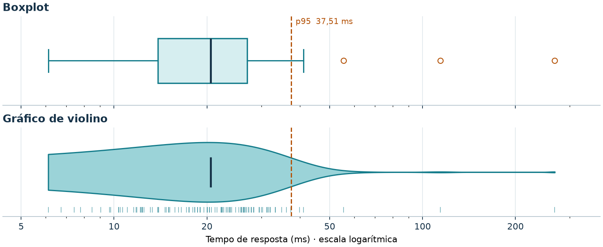

# AV2 · Monitoramento da triagem LAI

## 1. Tempo de resposta de `POST /score`

Em 24/11/2026, foram feitas 100 chamadas sequenciais ao serviço local com o
mesmo pedido e o modelo `provided-2026-09-21`. Todas retornaram HTTP 200. O
cliente cronometrou cada chamada até a leitura do corpo inteiro. Os percentis
foram calculados por interpolação linear sobre os tempos ordenados. [Medições individuais e estatísticas](../reports/av2/latency_percentiles.json)

| Mediana | p90 | p95 | p99 | Máximo |
| ---: | ---: | ---: | ---: | ---: |
| 20,54 ms | 32,20 ms | 37,51 ms | 115,59 ms | 268,16 ms |

O p95 de **37,51 ms** ficou abaixo dos **400 ms** do SLA de exemplo. O
resultado se refere ao serviço local sob carga sequencial. Com 100 chamadas,
o p99 é interpolado entre as duas observações mais lentas e é sensível a elas.

O **boxplot** mostra os 50% centrais entre **13,87 e 27,02 ms**. Pela regra
de 1,5 × IQR, três observações ficaram acima do limite superior de 46,74 ms.
Elas ocorreram nas chamadas 41, 1 e 50, em ordem crescente de tempo, e duraram
55,49 ms, 114,05 ms e 268,16 ms. O **violino** é mais largo perto de 20 ms,
onde a densidade estimada é maior, e se afina à direita. Cada traço na base
marca uma chamada. O eixo logarítmico permite ver a concentração e a cauda na
mesma escala, com os valores marcados em milissegundos.

## 2. Conjuntos de referência e produção

A referência tem 100 pedidos sintéticos curados com órgãos e categorias do
vocabulário do pré-processador e histórico completo. O snapshot de treinamento
depende de acesso autorizado. A produção simulada tem 100 pedidos, incluindo
entradas mínimas, históricos completos e parciais, canais fora do vocabulário
e dois órgãos sintéticos. Os lotes foram submetidos separadamente e cada um
gerou 100 respostas HTTP 200 completas, com escore bruto registrado. [Pedidos de referência](../data/reference/score_inputs.jsonl) · [Pedidos de produção](../data/production/score_inputs.jsonl) · [Respostas de referência](../reports/av2/reference/scoring.jsonl) · [Respostas de produção](../reports/av2/production/scoring.jsonl)

## 3. Mudança nas variáveis monitoradas

| Variável | Métrica | Resultado |
| --- | --- | ---: |
| Entrada categórica `OrgaoDestinatario` | Population Stability Index (PSI) | **1,1289** |
| Saída contínua `prediction_raw` | Distância de Kolmogorov–Smirnov (KS D) | **0,4800** |

O PSI superou o limiar exploratório de 0,2. Os dois órgãos sintéticos somam
10% do lote de produção e respondem por cerca de 96% do índice. O cálculo
usa proporções por categoria, com piso de 10⁻⁶ para evitar logaritmos de zero.

A distância KS é a maior diferença entre as distribuições acumuladas. No
escore de aproximadamente 0,0975, **83%** dos pedidos de referência e **35%**
dos de produção tinham escore igual ou inferior a esse valor. A mediana
subiu de **0,0529** para **0,1031**. Essas medidas descrevem mudanças entre os
lotes. Avaliar o desempenho preditivo exigiria observar o desfecho real dos
pedidos. [Cálculos e contagens](../reports/av2/drift.json)

O [manual da AV2](MANUAL_AV2.md) orienta a reprodução dos números publicados
com `make reproduce-av2`, a abertura do dashboard e a execução de uma nova
coleta HTTP.
